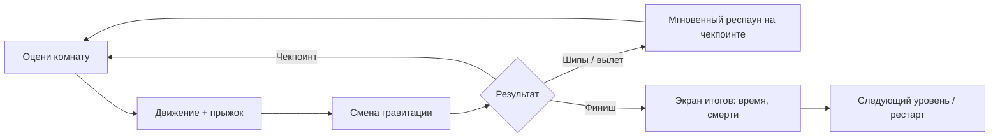

# Anti-Gravity Jump — Game Concept

> **Owner:** creative-director · **Contributors:** game-designer · **Status:** Approved (prototype) · **Date:** 2026-11-07

## Elevator Pitch

Короткий, плотный 2D-платформер, где игрок в любой момент поворачивает гравитацию
в одну из **четырёх сторон** (вниз / вверх / влево / вправо). Любая стена может
стать полом. Уровни — компактные «комнаты-головоломки» на 30–90 секунд с мгновенным
рестартом: «ещё одна попытка» — главный крючок.

## Game Pillars

| # | Pillar | Что это значит для решений |
|---|--------|----------------------------|
| P1 | **Любая поверхность — пол** | Каждый уровень обязан использовать минимум 2 направления гравитации. Никаких «декоративных» стен. |
| P2 | **Мгновенный ритм** | Смерть → рестарт < 0.5 с. Никаких катсцен и подтверждений в цикле попытки. |
| P3 | **Честная читаемость** | Игрок всегда видит текущую гравитацию и запас воздушных переключений. Смерть всегда объяснима. |
| P4 | **Простое управление, глубокие решения** | 3 действия: движение, прыжок, смена гравитации. Глубина — из геометрии уровня, а не из кнопок. |

## Anti-Pillars (чего НЕ делаем в прототипе)

- Никакого боя, врагов с ИИ, инвентаря, сюжета.
- Никакого вращения камеры по умолчанию (риск укачивания) — только опция-тюнинг.
- Никакой процедурной генерации.

## Target

- **Платформа:** PC (Windows), клавиатура + геймпад. **Движок:** Godot 4.x, GDScript.
- **Аудитория:** любители Celeste / VVVVVV / Gravity Guy; сессии 5–20 минут.
- **Scope прототипа:** 1 тестовый уровень (greybox), core-loop, HUD.

## Core Loop

## Systems (см. `systems-index.md`)

Gravity System · Player Movement · Level Flow (spawn / checkpoint / goal / death) · Hazards · Gravity Zones · HUD.
