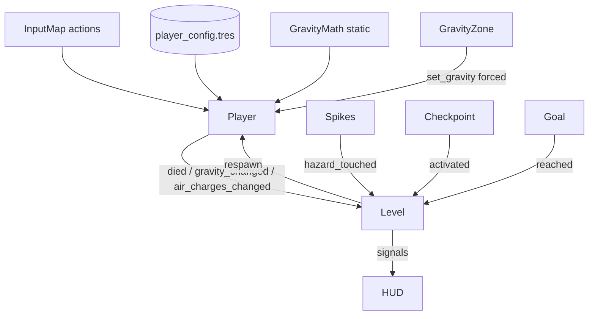

# ADR-0001: Кастомная гравитация игрока на CharacterBody2D

## Status
Accepted

## Date
2026-11-07

## Last Verified
2026-11-07 (Godot 4.7.2-stable)

## Decision Makers
technical-director (owner), lead-programmer, godot-gdscript-specialist

## Summary
Гравитация — свойство игрока (`GravityDir`), применяется вручную в `_physics_process`
поверх `CharacterBody2D.move_and_slide()` с динамическим `up_direction`.
Глобальная гравитация проекта и `Area2D.gravity_*` не используются.

## Engine Compatibility
Godot 4.2+ (typed GDScript, `CharacterBody2D.up_direction`, `@export_group`). Проверено на 4.7.2.

## ADR Dependencies
—

## Context

### Problem Statement
Нужна 4-сторонняя гравитация с корректными `is_on_floor()`, coyote time и прыжками
относительно любой поверхности.

### Constraints
- Детерминированность и «tight» контроль (не физический симулятор).
- Все параметры — во внешнем ресурсе (правило `gameplay-code`).

### Requirements
GDD: [gravity-system.md](../../design/gdd/gravity-system.md), [player-movement.md](../../design/gdd/player-movement.md).

## Decision

1. `GravityMath` (чистые статические функции, без состояния) — перевод `GravityDir` ↔ векторы, касательная ось, проекции. Полностью покрыт юнит-тестами.
2. `Player` (`CharacterBody2D`): хранит `gravity_dir`, раскладывает `velocity` на `v_t` (касательная) и `v_n` (вдоль гравитации), собирает обратно, ставит `up_direction = -g_dir`, вызывает `move_and_slide()`.
3. Коллайдер — квадрат 22×22 → инвариантен к повороту на 90°; вращается **только** узел `Visual`.
4. Параметры — `PlayerConfig` (`Resource`) → `assets/data/player_config.tres`.
5. Межсистемная связь — сигналы. `Level` — медиатор (инъекция зависимостей): подписывается на `Player`, раздаёт события HUD.

### Architecture Diagram



### Key Interfaces

```gdscript
# Player
signal died
signal gravity_changed(dir: int)          # GravityMath.Dir
signal air_charges_changed(charges: int, max_charges: int)
func set_gravity(dir: int, forced: bool = false) -> bool
func kill() -> void
func respawn(at: Vector2, dir: int) -> void
func freeze(value: bool) -> void

# Level
signal timer_updated(seconds: float)
signal deaths_changed(count: int)
signal level_completed(seconds: float, deaths: int)
```

## Alternatives Considered

### Alternative 1: RigidBody2D + `gravity_scale` / `PhysicsServer` gravity
Отклонено: «плавающее» управление, сложно сделать coyote/jump buffer, вращение тела.

### Alternative 2: Вращать весь мир/уровень вместо гравитации
Отклонено: ломает читаемость (P3), риск укачивания, сложно с несколькими объектами.

## Consequences

### Positive
Точный контроль, тестируемая математика, легко добавить врагов со своей гравитацией.
### Negative
Ручная интеграция скорости; движущиеся платформы потребуют доп. работы (`platform_floor_layers`).
### Neutral
Камера по умолчанию не вращается (опция в конфиге).

## Risks
- Застревание в углах при флипе → митигировано квадратным коллайдером + `safe_margin`. QA-кейс в test plan.

## Validation Criteria
AC-G1…AC-G6, AC-M1…AC-M5; `tests/run_tests.gd` = 0 failures.
