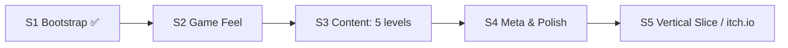

# Roadmap — Anti-Gravity Jump

> **Owner:** producer · **Date:** 2026-11-07

## Sprint 2 — Game Feel & Readability (1 неделя)
- Плейтест S1, сбор метрик (время/смерти по секциям).
- SFX: флип, отказ, приземление, смерть, финиш (sound-designer).
- Juice: squash & stretch, screen shake при смерти, trail во время флипа, частицы приземления (technical-artist).
- Индикатор «куда я упаду» (ghost-луч по направлению гравитации) — ключ к P3.
- Опция `camera_follows_gravity` + плавный поворот камеры; A/B на плейтесте.
- Пауза-меню, переключение подсказок.

## Sprint 3 — Content (1–2 недели)
- Переход с Block на TileMapLayer + TileSet (сохранить greybox-скрипты для триггеров).
- Новые механики (по одной на уровень): движущиеся платформы, «зоны без флипа», кнопки/двери, кристаллы-перезарядки воздушного флипа.
- 5 уровней с кривой сложности (`design/levels/difficulty-curve.md`).
- QA-бот-сценарии на каждый уровень (solve route).

## Sprint 4 — Meta & Polish
- Меню выбора уровней, сохранение лучших времён (`user://save.cfg`).
- Медали за время / 0 смертей, спидран-таймер.
- Арт-пасс (art-director → art bible), музыка-луп.
- Ремап управления, accessibility (контраст, slow-mo режим).

## Sprint 5 — Vertical Slice
- 10–12 уровней, экспорт Windows/Web, страница itch.io, сбор фидбека.

## Risks
| Risk | Митигирование |
|------|---------------|
| Укачивание/дезориентация при частых флипах | Камера не вращается по умолчанию, чёткая стрелка HUD, ghost-луч |
| Застревание в углах при флипе | Квадратный коллайдер, QA-бот на каждом уровне |
| Scope creep механик | Pillar P4: одна новая механика на уровень максимум |
